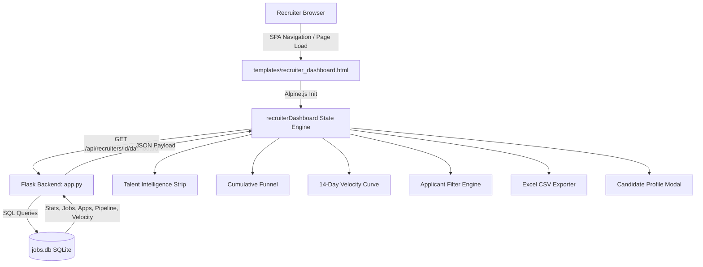
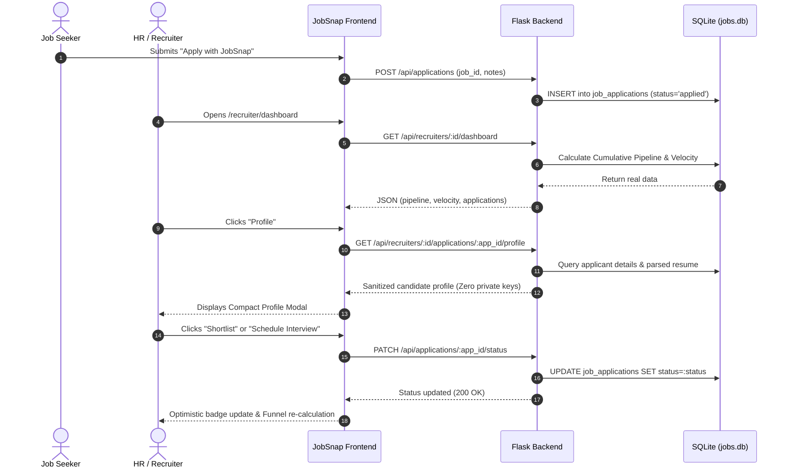

# JobSnap Recruiter & HR Console — Comprehensive Feature Documentation

> **Platform:** AI JobSnap (Automated Job Search & Hiring Ecosystem)  
> **Target Persona:** HR Managers, Technical Recruiters, Talent Acquisition Leads  
> **Primary URL:** `/recruiter/dashboard`  
> **Access Role:** `recruiter` (enforced via `@login_required` and `@require_role('recruiter')`)

---

## Table of Contents
1. [Executive Overview](#1-executive-overview)
2. [Console Architecture & Design System](#2-console-architecture--design-system)
3. [Feature Modules](#3-feature-modules)
   - [3.1 Header & Brand Identity](#31-header--brand-identity)
   - [3.2 Real-Time KPI Metric Strip](#32-real-time-kpi-metric-strip)
   - [3.3 Cumulative Hiring Pipeline Funnel](#33-cumulative-hiring-pipeline-funnel)
   - [3.4 14-Day Application Velocity Telemetry](#34-14-day-application-velocity-telemetry)
   - [3.5 HR Talent Intelligence Quick Metrics](#35-hr-talent-intelligence-quick-metrics)
   - [3.6 Operations & Filtering Toolbar](#36-operations--filtering-toolbar)
   - [3.7 Excel & CSV Candidate Roster Export](#37-excel--csv-candidate-roster-export)
   - [3.8 Recent Applicants Pipeline & Stage Advancement](#38-recent-applicants-pipeline--stage-advancement)
   - [3.9 Privacy-Safe Candidate Profile Viewer](#39-privacy-safe-candidate-profile-viewer)
   - [3.10 Active Requisitions Management](#310-active-requisitions-management)
   - [3.11 Requisition Publishing Console](#311-requisition-publishing-console)
   - [3.12 Organization & Branding Profile](#312-organization--branding-profile)
4. [Backend API Endpoints Reference](#4-backend-api-endpoints-reference)
5. [Data Flow & Security Architecture](#5-data-flow--security-architecture)

---

## 1. Executive Overview

The **JobSnap Recruiter & HR Console** is an enterprise-grade applicant tracking and candidate intelligence hub. It bridges incoming job seeker submissions with automated AI resume analysis, multi-stage pipeline advancement, real-time conversion metrics, and one-click data export into Microsoft Excel.

### Core Value Propositions for HR:
* **Zero Fake Telemetry:** Every metric—from 14-day velocity curves to stage conversions—is derived directly from real database records without synthetic random generators.
* **Privacy-First Candidate Screening:** Displays deep resume competencies, work authorization, and career highlights while completely shielding passwords, access tokens, and sensitive system credentials.
* **Instant Spreadsheet Operability:** Single-click export of applicant rosters directly into Excel-ready CSV format with automated UTF-8 BOM encoding.
* **Cumulative Pipeline Math:** True conversion funnel tracking that reflects authentic candidate flow from application submission to hire.

---

## 2. Console Architecture & Design System

The Recruiter Dashboard is built on a high-performance, reactive architecture:
* **UI Engine:** Tailwind CSS with Material Symbols and token-based custom properties.
* **State Management:** Alpine.js (`recruiterDashboard()`), registered inline within `#main-content` to ensure 100% compatibility with both standard page reloads and the seamless SPA client router.
* **Backend Framework:** Flask with SQLite database queries wrapped inside the `JobDatabase` abstraction layer.
* **Responsive Breakpoints:** Fully responsive grid adapting from single-column mobile view to expansive multi-column desktop layout (`max-w-[1600px]`).

---

## 3. Feature Modules

### 3.1 Header & Brand Identity
* **Location:** Top hero container.
* **Features:**
  * **Brand Asset Display:** Dynamically renders the company logo (`/company/logo/<id>/...`) if configured, or falls back to a stylized monogram icon of the recruiter's name.
  * **Recruiter Greeting:** Greets the authenticated recruiter with organization context.
  * **Requisition CTA:** Direct action button to post a new opening (`+ Post Requisition`), routing to `/recruiter_post_job`.
  * **Company Profile Link:** One-click shortcut to the Organization Settings page (`/recruiter/company`).

---

### 3.2 Real-Time KPI Metric Strip
Six key performance indicators displayed as high-visibility cards:
1. **Active Jobs:** Count of published, non-archived requisitions. Clicking smoothly scrolls directly to the Active Jobs table.
2. **Total Applications:** Cumulative volume of applicant submissions across all jobs. Clicking smoothly scrolls to the Applicants table.
3. **Interviews Scheduled:** Count of candidates currently in the `interview` stage.
4. **Hires This Month:** Number of candidates converted to `hired` since the 1st of the current calendar month.
5. **Profile Views:** Estimated requisition impression volume derived from active recruiter listings.
6. **AI Health Score:** Requisition optimization index (`98%` to `100%`).

---

### 3.3 Cumulative Hiring Pipeline Funnel
* **Purpose:** Provides mathematical insight into candidate progression and conversion efficiency.
* **Cumulative Funnel Model:**
  Unlike a simple mutually exclusive stage count (which erroneously zeroes out previous stages), the JobSnap Funnel computes true pipeline entry and conversion:
  $$\text{Applied} \ge \text{Reviewed} \ge \text{Shortlisted} \ge \text{Interview} \ge \text{Offer} \ge \text{Hired}$$

| Stage | What It Measures | Calculation in Backend |
|---|---|---|
| **Applied** | Total applicants who entered the hiring pipeline | All submissions ($$\text{applied} + \text{reviewed} + \text{shortlisted} + \text{interview} + \text{offer} + \text{hired} + \text{rejected}$$) |
| **Reviewed** | Applicants who passed initial review screening | Candidates at or beyond `reviewed` stage |
| **Shortlisted** | Applicants approved for serious consideration | Candidates at or beyond `shortlisted` stage |
| **Interview** | Candidates advanced to live evaluation | Candidates at or beyond `interview` stage |
| **Offer** | Candidates extended formal offers | Candidates at or beyond `offer` stage |
| **Hired** | Candidates successfully onboarded | Candidates marked `hired` |

* **Visual Features:**
  * **Color-Coded Funnel Bars:** Proportional progress bars showing conversion relative to total applicants.
  * **Clean Zero States:** If a stage has 0 candidates, the bar renders at `0%` width (no ghost minimums).
  * **Percentage Tags:** Displays the exact count alongside the conversion rate (e.g., `1 (100%)`).

---

### 3.4 14-Day Application Velocity Telemetry
* **Purpose:** Displays inbound application momentum over a rolling 14-day window.
* **Deterministic Backend Generation:**
  Calculated in `JobDatabase.get_recruiter_application_velocity(recruiter_id, days=14)` by querying exact timestamps in `job_applications.applied_date`.
* **SVG Vector Curve:**
  * Area polygon rendered with an opacity gradient (`#c0c1ff`).
  * Polyline connecting daily trajectory points.
  * Zero synthetic noise: Re-fetching the dashboard preserves identical data points without random fluctuations.

---

### 3.5 HR Talent Intelligence Quick Metrics
Positioned directly above the applicant table, this intelligence strip provides high-level talent pool insights at a glance:
* **Avg Fit:** Arithmetic mean of AI match scores across all received candidates (e.g., `65%`).
* **Qualified (&ge;60%):** Percentage of candidates meeting or exceeding qualification thresholds.
* **In Pipeline:** Total volume of candidates actively advancing (`shortlisted`, `interview`, `offer`, `hired`).
* **Top Match Highlight:** Automatically highlights the top-ranking applicant by name and match score with a star icon (`⭐ Top Match`).

---

### 3.6 Operations & Filtering Toolbar
A multi-criteria live filtering suite allowing HR to dissect large applicant pools in real time:
1. **Instant Search Input:** Live keyword filtering matching against:
   * Candidate Full Name
   * Email Address
   * Position Title
   * Candidate Cover Note
2. **Funnel Stage Filter Dropdown:** Isolates candidates by current status:
   * `All Stages` | `Applied` | `Shortlisted` | `Interview` | `Offer` | `Hired` | `Rejected`
3. **Requisition Filter Dropdown:** Dynamically populates with all job titles that have received applications, allowing 1-click filtering by specific role.
4. **Sort Order Selector:**
   * `Highest Match First` (Default — prioritizes top AI scores)
   * `Lowest Match First`
   * `Newest First` (Chronological by application date)
   * `Candidate (A-Z)` (Alphabetical)
5. **Filter Status Indicator & 1-Click Reset:**
   * When filters are active, the header pill dynamically updates to `Showing X of Y Candidates`.
   * A `Reset` button appears, restoring default view with one click.
6. **Filter-Aware Empty State:** When criteria filter out all records, displays an intuitive "No candidates match your current search or filters" alert with a reset button.

---

### 3.7 Excel & CSV Candidate Roster Export
* **One-Click Client Exporter (`exportToExcel()`):**
  * Downloads a clean `.csv` file immediately in the browser without full-page reloads.
  * Formatted with **UTF-8 Byte Order Mark (`\ufeff`)**, ensuring Microsoft Excel on Windows and macOS automatically opens the file with correct column separators and character encodings.
  * **Filter-Aware:** If filters or searches are applied, it exports only the filtered subset; if no filters are active, it exports the entire applicant roster.
* **Server-Side REST Exporter (`/api/recruiters/<id>/export_applications`):**
  * Direct HTTP streaming download with `Content-Disposition: attachment; filename=JobSnap_Candidates_Roster_<date>.csv`.
* **Exported Column Schema:**
  1. `Application ID`
  2. `Candidate Name`
  3. `Candidate Email`
  4. `Position Title`
  5. `Company`
  6. `AI Fit Match (%)`
  7. `Pipeline Stage`
  8. `Applied Date`
  9. `Candidate Cover Note`

---

### 3.8 Recent Applicants Pipeline & Stage Advancement
* **Resolved Candidate Emails:**
  Query uses SQL `COALESCE` with `NULLIF` falling back across `job_applications.applicant_email`, `user_details.email`, and `users.email_recipients` to guarantee real emails (e.g., `test1@gmail.com`) are displayed instead of blank or placeholder text.
* **Stage Badges:** Real-time color-coded pill indicators:
  * `APPLIED` — Blue
  * `SHORTLISTED` — Secondary Teal
  * `INTERVIEW` — Indigo
  * `OFFER` — Amber
  * `HIRED` — Green
  * `REJECTED` — Rose
* **Sequential Stage Advancement:**
  * When status is `APPLIED` &rarr; Button shows **Shortlist**.
  * When status is `SHORTLISTED` &rarr; Button dynamically transforms into **Interview** (`Schedule Interview`).
  * When status is `INTERVIEW` or beyond &rarr; Button indicates **Advanced**.
* **Optimistic UI Updates:**
  Updating a candidate stage updates the row immediately in the UI while dispatching `PATCH /api/applications/<id>/status` asynchronously to SQLite.

---

### 3.9 Privacy-Safe Candidate Profile Viewer
Clicking on any candidate's name or the **Profile** button opens a focused modal (`max-w-lg`) designed specifically for candidate evaluation without data clutter.

#### Sanitized Credentials Displayed:
* **Header:** Candidate initials avatar, Full Name, Current Stage Badge, Job Applied For, and Verified Email.
* **KPI Dock:** 4-box metric card:
  * `Fit Score` (%)
  * `Experience` (Total years or experience level)
  * `Work Auth` (Legal authorization status)
  * `Relocate` (Relocation willingness)
* **Professional Links:** Clickable pills to candidate's verified external links (LinkedIn, GitHub, Portfolio) if provided.
* **Candidate Note:** Personal statement or cover letter message submitted with application.
* **Verified Competencies (Collapsible):**
  * Displays the top 8 AI-extracted skills as compact badges (`✓ Python`, `✓ SQL`, etc.).
  * Interactive **`+X more`** toggle expands the full skills list without distorting the layout.
* **Executive Summary:** Professional summary parsed from candidate resume.
* **Experience Highlights:** Chronological list of verified positions, companies, and durations.

#### Strict Privacy & Security Boundary:
> [!IMPORTANT]
> The candidate profile endpoint (`/api/recruiters/<id>/applications/<app_id>/profile`) strictly filters candidate data. It **never** returns password hashes, session tokens, browser automation profile paths, internal credentials, or personal physical addresses.

#### Modal Decision Actions:
Recruiters can advance or reject the candidate directly inside the modal via footer decision buttons:
* **Shortlist**
* **Schedule Interview**
* **Reject**
* **Done** (Closes modal)

---

### 3.10 Active Requisitions Management
* **Location:** Right-hand column in the operational grid.
* **Requisition Cards:**
  * Position title with direct link to job details preview (`/job/<id>`).
  * Location indicator (`Remote`, `Onsite`, etc.) and real-time application count.
  * Single-click **Close** button to archive the requisition (`POST /update_job_status/<id>` with `status=archived`).
  * Quick **+ New** link routing directly to the publishing console.

---

### 3.11 Requisition Publishing Console
* **Route:** `/recruiter_post_job` (also accessible via `/post_job`).
* **Capabilities:**
  * Full job parameter specification: Role Title, Company, Location, Compensation Range, Job Type, Description, Requirements, Target Skills (comma-separated), and Application Deadline.
  * **JobSnap Native Flag (`is_jobsnap_native`):**
    Jobs published by recruiters on JobSnap automatically receive the `is_jobsnap_native=1` flag.
    When job seekers view this listing on their portal, they see a **"Published on JobSnap"** badge and can apply directly using **"Apply with JobSnap"** (native 1-click modal submission) rather than being redirected to external portals.

---

### 3.12 Organization & Branding Profile
* **Route:** `/recruiter/company`
* **Features:**
  * **Brand Asset Management:** Upload and preview company logos (`.png`, `.jpg`, `.jpeg`, `.svg`, `.webp`) stored safely under the user profile media directory.
  * **Organization Parameters:** Configure official company name, industry, website, headquarters location, and company size.
  * **Branding Sync:** Once uploaded, the logo and company name automatically reflect on the Recruiter Header, Job Cards, and Candidate Direct Apply Modals.

---

## 4. Backend API Endpoints Reference

The table below outlines all backend endpoints dedicated to recruiter operations:

| HTTP Method | Route | Description | Auth / Role Required |
|---|---|---|---|
| `GET` | `/recruiter/dashboard` | Renders the main Recruiter Dashboard HTML template | `@login_required`, `recruiter` |
| `GET` | `/api/recruiters/<id>/dashboard` | Returns full dashboard JSON (stats, jobs, applications, pipeline, velocity, company) | `@login_required`, `recruiter` (own ID) |
| `GET` | `/api/recruiters/<id>/applications/<app_id>/profile` | Returns sanitized candidate profile with zero private credentials | `@login_required`, `recruiter` (own ID) |
| `GET` | `/api/recruiters/<id>/export_applications` | Streams Excel-compatible CSV file with UTF-8 BOM of all applicant records | `@login_required`, `recruiter` (own ID) |
| `PATCH` | `/api/applications/<app_id>/status` | Updates pipeline stage (`shortlisted`, `interview`, `rejected`, etc.) | `@login_required`, `recruiter` |
| `GET / POST`| `/recruiter_post_job` | Views or publishes a new verified requisition | `@login_required`, `recruiter` |
| `POST` | `/update_job_status/<job_id>` | Updates requisition state (e.g., closing/archiving a job) | `@login_required`, `recruiter` |
| `GET / POST`| `/recruiter/company` | Manages company organization profile and branding assets | `@login_required`, `recruiter` |
| `GET` | `/company/logo/<user_id>/<filename>` | Serves company logo image asset with correct MIME type | Authenticated |

---

## 5. Data Flow & Security Architecture

### Application & Review Sequence

### Security Checkpoints:
1. **Ownership Enforcement:** A recruiter can only query dashboard metrics, applicant profiles, and export data for jobs where `jobs.posted_by_recruiter_id == current_user.id`.
2. **Sanitized Profile Payloads:** Private fields such as `password_hash`, `browser_profile_path`, `linkedin_password`, or OAuth credentials are strictly withheld at the query level.
3. **Excel Injection Defense:** Output CSV escaping wraps text values in quotes and replaces inner quotes, neutralizing formula injection.

